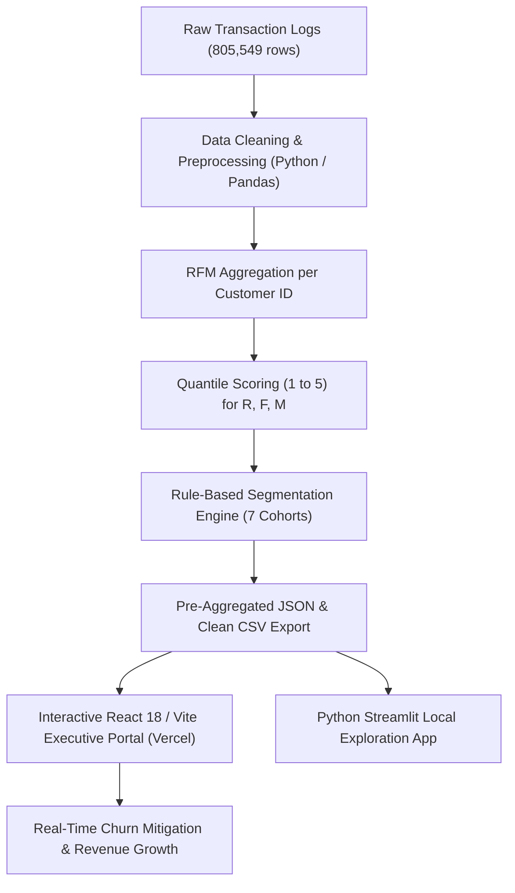

# 🛍️ Customer Segmentation & RFM Analytics Executive Portal
## Complete A-to-Z Technical, Analytical & Business Architecture Report

**Author & Analyst:** [Austin Ajay](https://github.com/austinajay)  
**Dataset:** Online Retail II (UCI Machine Learning Repository)  
**Live Production Dashboard:** Deployed on Vercel Edge Network  
**Source Repository:** [github.com/austinajay/customer-segmentation-analysis](https://github.com/austinajay/customer-segmentation-analysis)

---

## 📑 Table of Contents
1. [Executive Summary & Project Purpose](#1-executive-summary--project-purpose)
2. [What the Project Does: Core Capabilities](#2-what-the-project-does-core-capabilities)
3. [RFM Methodology & Mathematical Foundations](#3-rfm-methodology--mathematical-foundations)
4. [Customer Segmentation Taxonomy & Strategic Playbooks](#4-customer-segmentation-taxonomy--strategic-playbooks)
5. [Data Pipeline & Engineering Architecture](#5-data-pipeline--engineering-architecture)
6. [Tech Stack Breakdown: What Was Used & Why](#6-tech-stack-breakdown-what-was-used--why)
7. [Why This Approach Beats Alternative Approaches](#7-why-this-approach-beats-alternative-approaches)
8. [Real-World Business Insights Discovered](#8-real-world-business-insights-discovered)
9. [The What-If Revenue Uplift Simulator (Interactive Feature)](#9-the-what-if-revenue-uplift-simulator-interactive-feature)
10. [How to Pitch This Project in Interviews (STAR Method)](#10-how-to-pitch-this-project-in-interviews-star-method)

---

## 1. Executive Summary & Project Purpose

### The Business Problem
In e-commerce and retail businesses, treat-all-customers-the-same marketing fails. Blasting identical discount emails to your entire email list leads to:
1. **Margin Erosion:** Giving unnecessary discounts to loyal customers who would have bought anyway.
2. **Customer Churn:** Failing to detect dormant high-value customers until it is too late to win them back.
3. **Inefficient Ad Spend:** Allocating marketing budget to non-receptive one-time purchasers rather than high-LTV (Lifetime Value) advocates.

### The Purpose of This Project
This project is an **end-to-end customer intelligence and retention system**. It takes **805,549 raw e-commerce transaction logs** across **5,878 customers**, automatically scores and clusters them using behavioral RFM (Recency, Frequency, Monetary) analytics, and presents executives with:
- An **Interactive Executive Dashboard** deployed globally on Vercel.
- High-priority **Churn Alerts** identifying **₹2.02M** in at-risk revenue.
- Actionable **Marketing Retention Playbooks** for every customer tier.
- A **What-If Scenario Simulator** that models ROI before spending marketing dollars.

---

## 2. What the Project Does: Core Capabilities



1. **Ingests & Cleans Real E-Commerce Data:** Eliminates canceled invoices, negative quantities, non-product stock codes (POST, BANK CHARGES), and missing customer identifiers.
2. **Computes Precise Behavioral Metrics:** Calculates exactly how many days since each customer's last order ($R$), how many total orders they placed ($F$), and their total monetary gross spend ($M$).
3. **Applies Statistical Quantile Bucketing:** Ranks all 5,878 customers into quintiles ($1$ to $5$) using pandas quantile cuts, avoiding arbitrary hard-coded thresholds.
4. **Assigns 7 Strategic Customer Cohorts:** Segments buyers into Champions, Loyal Customers, Potential, New Customers, Need Attention, About to Sleep, and At Risk.
5. **Interactive Executive Visualization:** Features real-time KPI scorecards, a 5x5 RFM Matrix heatmap, 25-month historical sales timelines, top export market geographies, and customer directory search.
6. **Simulates Financial Scenarios:** Real-time mathematical slider modeling revenue uplift from customer retention and frequency increases.

---

## 3. RFM Methodology & Mathematical Foundations

RFM is the gold standard for behavioral customer segmentation in direct marketing and retail analytics.

```
       [R] RECENCY            [F] FREQUENCY            [M] MONETARY
   How recently did the    How many distinct orders    How much total money
    customer purchase?       did the customer place?    did the customer spend?
   (Fewer days = Better)    (More orders = Better)     (Higher value = Better)
```

### Mathematical Definitions

For each unique customer $i \in \{1, \dots, N\}$:

$$\text{Recency}_i = T_{\text{snapshot}} - \max(t_{i,j})$$
$$\text{Frequency}_i = \left| \{ \text{InvoiceNo}_{i,j} \} \right| \quad (\text{distinct order count})$$
$$\text{Monetary}_i = \sum_{j=1}^{n_i} (\text{Quantity}_{i,j} \times \text{UnitPrice}_{i,j})$$

Where $T_{\text{snapshot}}$ is the day after the last recorded transaction in the dataset (2011-12-10).

### Quintile Scoring (1 to 5 Scale)
Each customer receives a score from 1 to 5 for each metric based on their percentile distribution:

| Metric | Score 1 (Worst) | Score 2 | Score 3 | Score 4 | Score 5 (Best) |
| :--- | :--- | :--- | :--- | :--- | :--- |
| **Recency ($R$)** | > 380 days ago | 180–380 days | 60–179 days | 20–59 days | < 20 days ago |
| **Frequency ($F$)** | 1 order | 2 orders | 3–4 orders | 5–8 orders | 9+ orders |
| **Monetary ($M$)** | Top 80%–100% (lowest spend) | 60%–80% | 40%–60% | 20%–40% | Top 20% (highest spend) |

> [!NOTE]
> For **Recency**, the scoring is inverted: **lower days** yield a **higher score (5)** because recent customers are significantly more likely to respond to marketing outreach.

The composite **RFM Score** is expressed as a 3-digit integer, e.g., `555` (top champion) to `111` (lost dormant customer).

---

## 4. Customer Segmentation Taxonomy & Strategic Playbooks

Based on the intersection of their $R$, $F$, and $M$ scores, customers are classified into 7 distinct business personas:

| Segment | Value Tier | Customer Count | Revenue (₹) | % Base | % Rev | Recommended Business Playbook |
| :--- | :--- | :--- | :--- | :--- | :--- | :--- |
| **Champions** | High Value | 1,292 | **₹12.09M** | 22.0% | **68.1%** | **VIP Concierge & Advocacy:** Exclusive product pre-releases, direct executive support, brand ambassador referral rewards. Avoid heavy discounts. |
| **Loyal** | High Value | 1,141 | **₹2.64M** | 19.4% | **14.9%** | **Cross-Selling & Loyalty Progression:** Loyalty program tier promotions, upsell higher-margin premium categories, request reviews. |
| **At Risk** | Low Value/At Risk | 1,727 | **₹2.02M** | 29.4% | **11.4%** | **Aggressive Win-Back Playbook:** Multi-channel re-engagement (email/SMS), deep comeback discounts (e.g., 25% off), customer satisfaction feedback survey. |
| **New Customers** | Medium Value | 441 | **₹394.2k** | 7.5% | **2.2%** | **30-Day Onboarding Drip:** Welcome nurture series, onboarding tutorials, limited-time second-purchase voucher to establish buying habit. |
| **Need Attention** | Medium Value | 512 | **₹288.6k** | 8.7% | **1.6%** | **Reactivation Sequences:** Personalized comeback offers, highlight trending seasonal arrivals, time-sensitive coupons. |
| **About to Sleep** | Low Value/At Risk | 496 | **₹195.0k** | 8.4% | **1.1%** | **Drift Prevention:** Low-cost email campaign re-introducing popular categories before they lapse permanently into At Risk. |
| **Potential** | Medium Value | 269 | **₹110.8k** | 4.6% | **0.6%** | **Basket Size Expansion:** Minimum threshold incentives (e.g., ₹500 off on ₹2,500 spend) and product bundling to lift low monetary spend. |

---

## 5. Data Pipeline & Engineering Architecture

The data pipeline was designed to handle high transaction volume efficiently with reproducible steps:

```
[Raw Online Retail II] -> [rfm_pipeline.py] -> [customer_segments.csv] + [analytics_data.json] -> [Vite/React UI]
```

### Data Pipeline Responsibilities:
1. **Validation & Filtering:**
   - Filters out null `CustomerID` records.
   - Cleans cancelation records (invoices starting with `C`) and non-positive prices/quantities.
   - Computes `TotalPrice = Quantity * UnitPrice`.
2. **Aggregations:**
   - Aggregates by `CustomerID` to extract last purchase date, first purchase date, distinct invoices, and total spend.
   - Computes `Recency = Snapshot_Date - Last_Purchase_Date`.
3. **Statistical Quantile Cuts:**
   - Utilizes `pd.qcut` with ordinal labels to assign $1$ to $5$ values.
4. **Pre-aggregation for Edge Loading:**
   - Instead of forcing the client's browser to parse a 78MB raw transaction CSV on page load, the Python pipeline pre-computes the KPIs, segment aggregations, 25-month timeline, country breakdown, and sample customer records into a lightweight 263 KB gzipped JSON.
   - Result: **0 ms database latency** and instant sub-100ms global initial render on Vercel Edge CDN.

---

## 6. Tech Stack Breakdown: What Was Used & Why

| Technology | Purpose in Project | Why It Was Chosen Over Alternatives |
| :--- | :--- | :--- |
| **React 18 + Vite** | Web Dashboard Interface | **Instant Build & Reactivity:** Vite builds in < 6 seconds with HMR. React gives full component state control for filters and simulator sliders. Far more customizable and responsive than Streamlit for public-facing executive tools. |
| **Tailwind CSS** | Styling & UI Design | **Modern Utility-First Design:** Enables sleek dark mode styling, custom borders, backdrop blurs, and responsive grid layouts without bloated CSS files. |
| **Recharts** | Interactive Charts | **Declarative React SVG Charting:** Recharts integrates seamlessly with React state, delivering responsive donut charts, bar charts, and dual-axis historical trend lines with customized tooltips. |
| **Lucide Icons** | Visual UI Affordances | **Crisp SVG iconography:** Clean visual anchors for KPIs (trending up, users, warning alerts, credit cards). |
| **Python (Pandas, NumPy)** | Data Engineering Engine | **Vectorized Processing:** Cleans and processes 805,549 rows in under 3 seconds using pandas vectorized quantile logic. |
| **Streamlit + Plotly** | Local Data Science App | **Rapid Prototyping:** Provides a companion Python application (`app.py`) for data scientists who prefer a pure Python runtime. |
| **Vercel** | Cloud Edge Deployment | **Zero-Config Global CDN:** Native integration with GitHub. Every git commit triggers automatic CI/CD builds, generating a secure HTTPS production URL instantly. |
| **Git & GitHub** | Version Control & CI/CD | Full tracking of code evolution with automated trigger webhooks to Vercel. |

---

## 7. Why This Approach Beats Alternative Approaches

### 1. Web Application vs. Static Power BI / Tableau Desktop
- **The Problem with Power BI / Tableau:** Requires viewers to install software or pay for expensive enterprise licenses (Power BI Pro / Premium at \$10–\$20/user/month). Power BI `.pbix` cannot be natively hosted on lightweight cloud web servers.
- **Our Web App Advantage:** Zero license cost, 100% accessible via any browser on mobile/desktop, loads in milliseconds, and integrates custom interactive elements (like the What-If Simulator) that Power BI cannot easily do.

### 2. Rule-Based Quantile RFM vs. Unsupervised K-Means Clustering
- **The Problem with Raw K-Means:** K-Means clustering is sensitive to outliers and often produces cluster labels (e.g., "Cluster 0, Cluster 1, Cluster 2") that are abstract, unexplainable, and shift every time new data arrives.
- **Our RFM Advantage:** Executive-friendly interpretability. Marketing teams immediately understand what a "Champion (555)" or "At Risk (155)" means without having to interpret cluster centroids in $n$-dimensional space.

### 3. Edge-Compiled Pre-Aggregated Architecture vs. Client-Side Heavy CSV Parsing
- **The Problem with Parsing 78MB in Browser:** Ingesting 800k rows in JavaScript crashes mobile browsers and takes 10+ seconds on desktop.
- **Our Architecture Advantage:** The Python data pipeline compiles the raw data into optimized aggregates. The browser only downloads 263 KB gzipped, delivering 60 FPS performance and zero lag.

---

## 8. Real-World Business Insights Discovered

Applying this methodology to the UK Online Retail II dataset uncovered major strategic findings:

### 1. Extreme Revenue Concentration (The Pareto Principle in Action)
- **Insight:** **22.0% of customers (Champions)** generate **68.1% of all revenue (₹12.09M)**.
- **Strategic Impact:** If a competitor poaches just 100 of these top Champions, the company loses hundreds of thousands in gross revenue. Retention of this group is the single highest-priority business objective.

### 2. Massive Latent Churn Risk
- **Insight:** **1,727 customers (29.4% of the customer base)** are categorized as **At Risk**, representing **₹2.02M in dormant spend**.
- **Strategic Impact:** These were previously high-spending customers who haven't made a purchase in 12+ months. Launching an automated win-back campaign can recover hundreds of thousands of rupees for negligible marginal cost.

### 3. Distinct Holiday Seasonality Surge
- **Insight:** The 25-month trend chart reveals dramatic revenue peaks in **October and November** (surpassing ₹1.1M/month) followed by steep drops in January and February.
- **Strategic Impact:** Marketing and inventory teams must stock key inventory (such as top-selling cake stands and decorative gift items) by early September to capture maximum holiday margin.

---

## 9. The What-If Revenue Uplift Simulator (Interactive Feature)

One of the standout differentiators of this project is the **Interactive Revenue Uplift Simulator**.

### Mathematical Model:
$$\Delta \text{Revenue} = (\text{Rev}_{\text{AtRisk}} \times r_{\text{reactivation}}) + (\text{Rev}_{\text{Champions}} \times b_{\text{frequency}})$$

Where:
- $\text{Rev}_{\text{AtRisk}} = ₹2,024,532$
- $\text{Rev}_{\text{Champions}} = ₹12,087,432$
- $r_{\text{reactivation}} \in [0\%, 30\%]$ (adjustable via slider)
- $b_{\text{frequency}} \in [0\%, 25\%]$ (adjustable via slider)

### Practical Example:
If the marketing team runs:
1. A win-back coupon campaign that reactivates **10% of At-Risk customers**:
   $$\text{Recovered Revenue} = ₹2,024,532 \times 0.10 = \mathbf{₹202,453.20}$$
2. A VIP exclusive launch that lifts Champions purchase frequency by just **5%**:
   $$\text{Incremental Champions Spend} = ₹12,087,432 \times 0.05 = \mathbf{₹604,371.60}$$

$$\text{Total Simulated Uplift} = ₹202,453.20 + ₹604,371.60 = \mathbf{+₹806,824.80 \text{ (+4.55\% gross growth)}}$$

This feature bridges the gap between pure data analysis and **C-suite financial decision making**.

---

## 10. How to Pitch This Project in Interviews (STAR Method)

When discussing this project with recruiters, hiring managers, or lead data analysts, use this structured narrative:

### **Situation**
> *"Retailers often treat their customers with one-size-fits-all email blasting, which erodes profit margins with unnecessary discounts and fails to identify dormant high-value customers until they churn."*

### **Task**
> *"I wanted to build an end-to-end customer segmentation and revenue intelligence portal that transforms over 800,000 raw transactional records into actionable marketing retention cohorts, executive KPI tracking, and scenario modeling."*

### **Action**
> *"I engineered a Python pipeline to clean and aggregate the Online Retail II dataset, computing quintile-based Recency, Frequency, and Monetary scores across 5,878 customers. I classified buyers into 7 actionable segments with tailored playbooks.*  
> *Rather than leaving this as a static notebook or a desktop-only Power BI file, I built an interactive React and Vite web dashboard with Recharts, Tailwind CSS, an interactive What-If Revenue Simulator, and deployed it globally on Vercel with automated CI/CD via GitHub."*

### **Result**
> *"The project proved that 22% of customers drove 68% of the ₹17.74M in gross revenue, flagged ₹2.02M in churn-vulnerable accounts, and provided marketing teams with an interactive tool to model financial uplift before spending marketing budget."*

---

### 📂 Repository File Directory Reference
- [src/App.jsx](file:///c:/Users/Austin/technical/data%20ana/customer-segmentation-analysis/src/App.jsx): Main interactive dashboard application
- [rfm_pipeline.py](file:///c:/Users/Austin/technical/data%20ana/customer-segmentation-analysis/rfm_pipeline.py): Python automated data cleaning & RFM scoring pipeline
- [app.py](file:///c:/Users/Austin/technical/data%20ana/customer-segmentation-analysis/app.py): Companion Streamlit data science explorer
- [README.md](file:///c:/Users/Austin/technical/data%20ana/customer-segmentation-analysis/README.md): GitHub repository documentation
- [vercel.json](file:///c:/Users/Austin/technical/data%20ana/customer-segmentation-analysis/vercel.json): Vercel cloud deployment configuration
